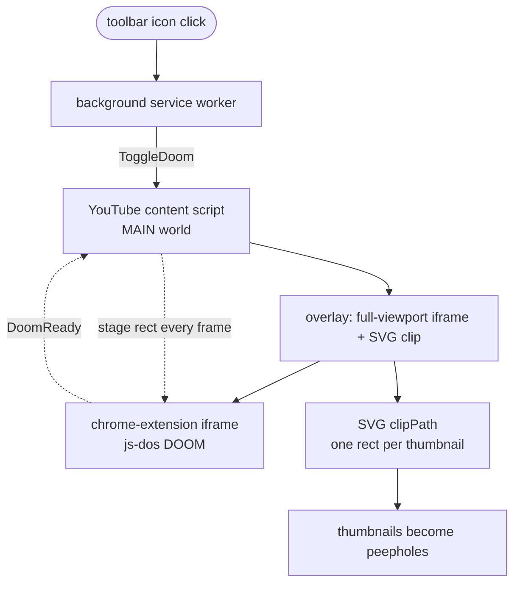
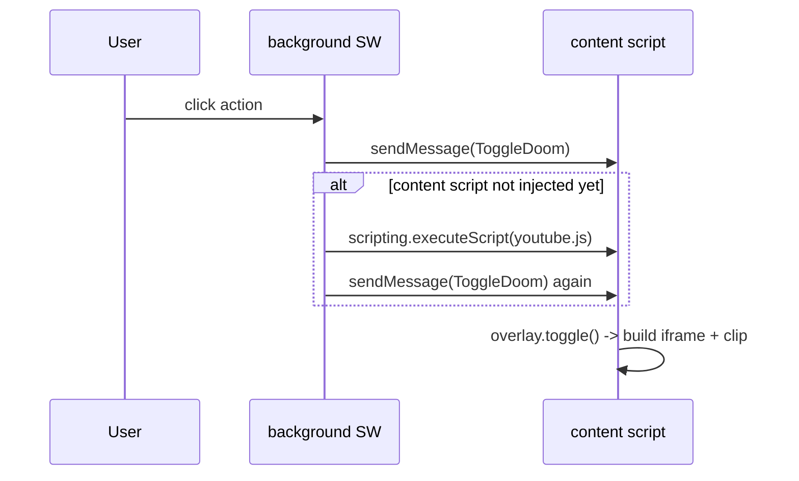
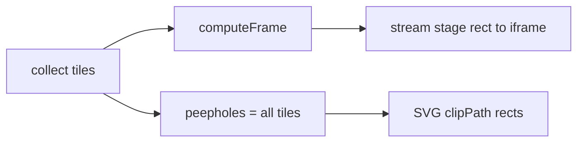
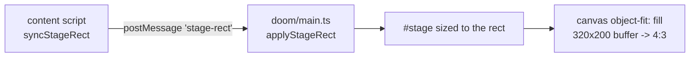

# Architecture

How one live DOOM ends up peering through every YouTube thumbnail.

## The core idea

There is exactly **one** DOOM. It runs full-viewport, behind the page, inside a single
`chrome-extension://` iframe. Every thumbnail is just a **peephole** cut into that iframe with an
SVG `clipPath` - each thumbnail shows its own slice of the same shared game. Nothing is duplicated
per thumbnail; there is one emulator, one canvas, one audio stream.



## The three contexts

| Context | File | Runs where | Job |
| --- | --- | --- | --- |
| Background service worker | `src/entrypoints/background.ts` | extension | Toggle on action click; inject the content script if it is not there yet; relax YouTube's `frame-src` via `declarativeNetRequest` |
| Content script | `src/entrypoints/youtube.content.ts` + `src/lib/overlay.ts` | `youtube.com`, MAIN world | Own the overlay iframe, track thumbnail rects, drive the SVG clip, stream the stage rect |
| DOOM frame | `src/entrypoints/doom/` | extension-origin iframe | Boot js-dos DOOM, receive the stage rect, size the canvas |

The DOOM iframe is served from the **extension origin**, so the extension's own CSP - not YouTube's
- governs its WebAssembly. YouTube's page CSP would otherwise block js-dos.

## Toggling on



`background.ts` first tries to deliver `ToggleDoom`. If the tab has no content script yet (fresh
page, no reload since install), the send rejects; it then `executeScript`s the content script and
retries. This is why the extension needs the `scripting` permission.

## The projection algorithm

All of it lives in `src/lib/tiles.ts` -> `collectDoomProjection()`, run every animation frame. It
answers two questions: **where does the single 4:3 DOOM frame sit**, and **which thumbnails reveal
it**.



### 1. Collect tiles

Walk every grid item (`GRID_ITEM_SELECTOR`), resolve its thumbnail container (piercing the
`yt-lockup-view-model` shadow root when present), dedupe by container, and clip each rect to the
viewport below the fixed top chrome (masthead + filter chips). Two kinds of tile do **not** frame
the width:

- **Shorts** (`isShortsItem`) - a wide Shorts shelf must not stretch the frame across a narrow
  result column.
- **Channel avatars** (`ytd-grid-channel-renderer yt-img-shadow`, a channel page's "Featured
  Channels" row) - round peepholes that keep the game continuous across that row without dragging
  the frame around. Their 50% CSS radius is resolved to a true pixel circle in `readCornerRadius`.

Each tile carries a `framesWidth` flag capturing that distinction.

### 2. computeFrame

```
width  = horizontal extent of framing tiles only
height = width / (4/3), capped by the vertical extent of ALL tiles
left   = centred on the framing tiles' width
top    = anchored to the VIEWPORT centre, clamped inside the tile span
```

The 4:3 aspect keeps DOOM undistorted. Anchoring the vertical centre to the **viewport** (not to the
thumbnails' centre) is what stops the frame from snapping up and down as rows scroll in and out of
view.

### 3. Peepholes

**Every** viewport-clipped tile is a peephole - not clipped to the frame. Where a thumbnail overlaps
the frame it shows game pixels; everywhere else it reveals the iframe's black `#000` body. So
non-game thumbnails read as solid black, and a thumbnail straddling the frame edge is game on one
side and black on the other. This is intentional.

## Streaming the stage rect

The frame rect is pushed to the iframe on every layout change (scroll, resize, thumbnail load).



Two channels cross the frame boundary, deliberately kept separate:

- **`DoomReady`** - a one-shot handshake, sent once when DOOM boots, over typed
  `@webext-core/messaging/page` window messaging.
- **The stage rect** - a high-frequency one-way stream, sent over a **raw** `postMessage`
  (`sendStageRect` / `onStageRect`). The request/response messaging would leak an unanswered
  response listener per send across the frame, so it is not used for the stream.

Inside the iframe, `#stage` is positioned to the received rect and `#stage > canvas` is
`object-fit: fill`, so the 320x200 DOOM buffer stretches to the exact 4:3 rect - the game's
authentic pixel-aspect correction.

## CSP and embedding

YouTube's `frame-src` would refuse the extension iframe. The background worker installs a
`declarativeNetRequest` rule that relaxes `frame-src` for the YouTube document, and the iframe's own
WASM is allowed because it is served from the extension origin under the extension's CSP. js-dos v8
is **vendored** under `src/public/vendor` and patched to run under MV3's strict CSP (no
`unsafe-eval`, no `blob:`) - see [`src/public/vendor/PATCHES.md`](src/public/vendor/PATCHES.md).

## File map

```
src/
  entrypoints/
    background.ts          toggle + inject fallback + DNR frame-src rule
    youtube.content.ts     content-script entry; wires ToggleDoom -> overlay
    doom/
      index.html           iframe document; canvas object-fit rules
      main.ts              boots js-dos; applyStageRect; DoomReady handshake
  lib/
    overlay.ts             owns the iframe, runs the rAF loop, syncs clip + stage rect
    tiles.ts               collectDoomProjection: the projection algorithm
    clip.ts                builds/updates the SVG clipPath peepholes
    frame-messaging.ts     StageRect stream + DoomReady window messaging
    extension-messaging.ts typed ToggleDoom protocol (SW <-> content script)
    overlay.css            frame + clip styling; neutralizes hover previews
  public/vendor/           vendored, CSP-patched js-dos v8
```
