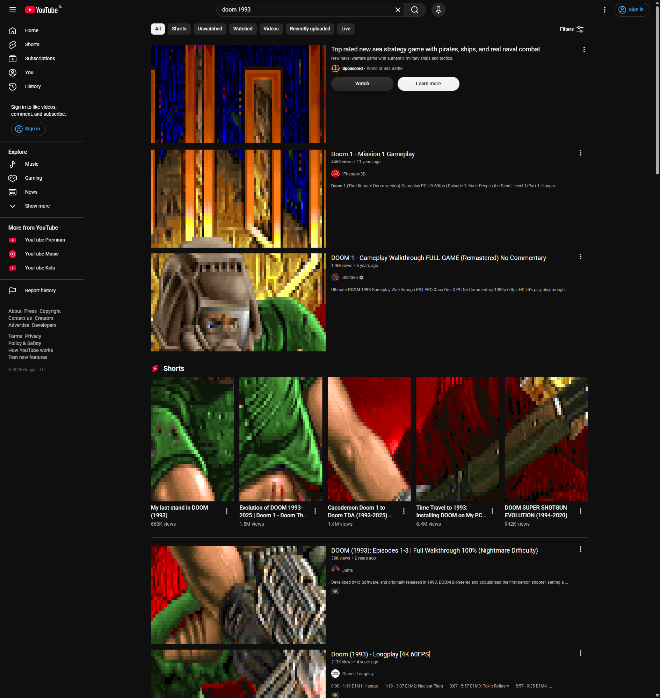

# DOOM in YouTube

Click the toolbar icon on YouTube and every thumbnail on the page becomes a peephole onto **one** live game of DOOM. There is a single full-viewport DOOM instance running behind the page - each thumbnail just shows you its own slice of it. Sound, keyboard and mouse all drive that one shared game. Click the icon again and everything DOOM-related is torn down and the page returns to normal.



## How it works

```
toolbar click
     |
     v
background service worker  --TOGGLE-->  YouTube content script
                                              |
                                              v
                                        one full-viewport <iframe> (extension origin)
                                        running js-dos DOOM
                                              |
                            clipped each frame to the union of all
                            visible thumbnail rects via an SVG <clipPath>
```

- A **content script** tracks every visible thumbnail rect (including Shorts) through YouTube's Polymer renderers, on scroll and resize.
- A single **full-viewport `chrome-extension://` iframe** runs js-dos DOOM. Because it is served from the extension origin, the extension's own CSP - not YouTube's - governs its WebAssembly.
- Each frame, the iframe is clipped to the bounding box of all thumbnails and an SVG `clipPath` punches a hole for each individual thumbnail, so the one game shows through every peephole at once.
- A **background service worker** toggles the overlay on the action click and relaxes YouTube's `frame-src` via `declarativeNetRequest` so the iframe can embed.
- Clicking a thumbnail captures keyboard and mouse into the game; `Esc` releases them.

For the projection algorithm, the stage-rect stream and the CSP handling, see [`ARCHITECTURE.md`](ARCHITECTURE.md).

## Controls

- **Toolbar icon** - toggle DOOM on, then off
- **Click a thumbnail** - capture keyboard + mouse into the game
- **Esc** - release input back to the page
- Standard DOOM keys - arrows/WASD to move, `Ctrl` to fire, `Space` to open doors

## Stack

- [WXT](https://wxt.dev) extension framework, Manifest V3
- TypeScript, zero runtime dependencies
- [js-dos](https://js-dos.com) v8 as the DOOM engine, vendored under `src/public/vendor` and patched to run under MV3's strict CSP (no `unsafe-eval`, no `blob:`) - see [`PATCHES.md`](src/public/vendor/PATCHES.md)
- Chromium only (Chrome, Edge, Opera)

## Develop

```bash
pnpm install
pnpm ext:dev        # WXT dev server with HMR (Chrome)
pnpm ext:dev:edge   # ...on Edge
```

Then load the extension from the dev server, open `youtube.com`, and click the toolbar icon.

```bash
pnpm lint    # oxlint (type-aware), --fix
pnpm check   # tsgo --noEmit
pnpm ext:build
```

## License

[MIT](LICENSE)
